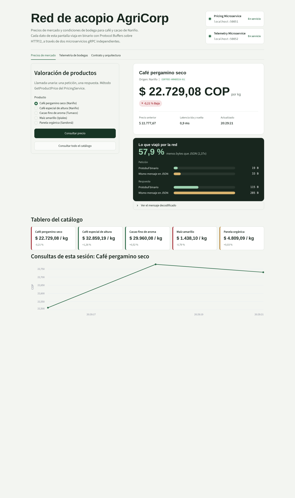
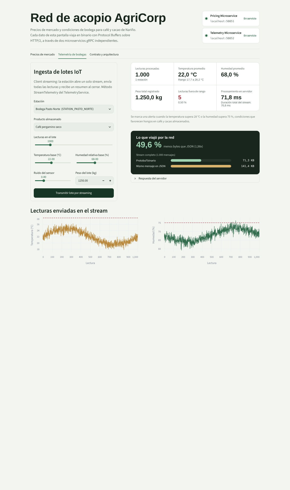
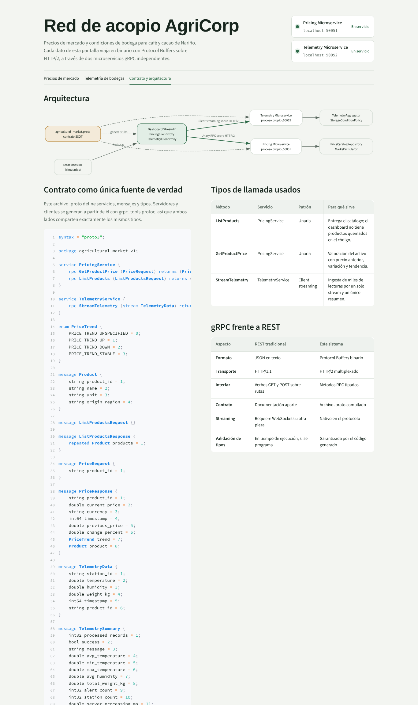

# Red de acopio AgriCorp: microservicios gRPC

Construí este sistema distribuido para una red de acopio de café y cacao en Nariño. En lugar de exponer una API REST con JSON sobre HTTP/1.1, diseñé todo a partir de un contrato Protocol Buffers y comuniqué los componentes con gRPC sobre HTTP/2, usando serialización binaria y streaming nativo.



## Qué resolví

- **Contrato como única fuente de verdad.** El archivo `protos/agricultural/v1/agricultural_market.proto` define servicios, mensajes y el enum `PriceTrend`. Servidores y clientes se generan desde ahí con `grpc_tools.protoc`; nadie escribe controladores HTTP ni tipos a mano. Amplié el contrato sin romper compatibilidad: los campos originales conservan sus números (1 a 4) y lo nuevo usa números nuevos.
- **Dos microservicios realmente independientes.** Cada uno corre en su propio proceso del sistema operativo, con su propio puerto y su propio health check (`grpc.health.v1`). Si detengo uno, el otro sigue atendiendo y el dashboard lo muestra.
  - **Pricing Microservice (50051)**: llamadas unarias `ListProducts` y `GetProductPrice`. Devuelve precio actual, precio anterior, variación porcentual y tendencia.
  - **Telemetry Microservice (50052)**: client streaming `StreamTelemetry`. Recibe miles de lecturas IoT por un solo stream y responde con un resumen: promedios, rango, peso total, alertas de almacenamiento y bytes recibidos.
- **Sin verbos HTTP.** No existe ningún `GET` ni `POST` en el backend; todo son métodos RPC tipados.
- **Evidencia de eficiencia.** Cada llamada mide el tamaño real del mensaje Protobuf y el del mismo mensaje en JSON compacto, y el dashboard muestra la diferencia. En un lote de 1.000 lecturas, Protobuf ocupa aproximadamente la mitad.
- **Programación orientada a objetos y SOLID.** Repositorio, simulador de mercado, política de almacenamiento, validador, agregador, servicers, proxys de cliente, sonda de salud e inspector de bytes son clases con una sola responsabilidad. Las dependencias se inyectan por constructor.
- **Errores gRPC con significado.** Uso `NOT_FOUND` para productos inexistentes, `INVALID_ARGUMENT` para lecturas fuera de rango y `UNAVAILABLE` cuando un servicio no responde; el dashboard traduce cada código a un mensaje claro.

## Estructura

```
protos/agricultural/v1/agricultural_market.proto   contrato SSOT
agricultural/v1/                                   código generado (pb2, pb2_grpc, pyi)
services/
  server_runner.py                                 servidor gRPC reutilizable con health check y apagado limpio
  pricing/                                         repositorio, simulador de mercado, servicer, servidor
  telemetry/                                       política, validador, agregador, servicer, servidor
clients/                                           proxys gRPC, sonda de salud, inspector de bytes, simulador IoT
frontend/                                          dashboard Streamlit (vistas, componentes, tema, i18n)
frontend/locales/es.json                           textos de la interfaz en español
tests/                                             pruebas de integración contra servidores gRPC reales
launcher.py                                        levanta los tres procesos y espera a que estén sanos
tools/generate_contracts.py                        regenera el código desde el .proto
```

## Cómo lo ejecuto en local

Necesito Python 3.12 o superior.

```bash
python -m venv .venv
.venv\Scripts\activate          # en Windows
source .venv/bin/activate       # en Linux o macOS
pip install -r requirements.txt
python tools/generate_contracts.py
python launcher.py
```

Abro `http://localhost:8501`. El launcher arranca el Pricing y el Telemetry como procesos separados, espera a que ambos respondan `SERVING` y luego inicia el dashboard.

Para correr las pruebas:

```bash
python -m pytest -q
```

Si quiero ver los microservicios en contenedores separados, uso Docker Compose:

```bash
docker compose up --build
```

## Cómo lo despliego en Render

Render ofrece un solo puerto público por servicio web, así que en la nube los tres procesos viven en el mismo contenedor y se comunican por `localhost` sobre HTTP/2; siguen siendo procesos independientes, cada uno con su puerto.

1. Subo este proyecto a mi repositorio de GitHub, reemplazando los archivos anteriores.
2. En Render, en el servicio `agricultural-microservice`, dejo el runtime en Docker. El `Dockerfile` instala dependencias, regenera el código desde el `.proto`, corre las pruebas y arranca con `python launcher.py`.
3. En Settings, pongo `/_stcore/health` como Health Check Path.
4. Hago Manual Deploy y elijo "Clear build cache & deploy".

También dejé un `render.yaml` por si prefiero crear el servicio como Blueprint.

## Telemetría y contrato





## Notas

- Los precios son de referencia y varían con un paseo aleatorio acotado (máximo 15 % alrededor del precio base) para simular un mercado en tiempo real.
- Una lectura genera alerta si la temperatura pasa de 28 °C o la humedad relativa pasa de 75 %, condiciones que favorecen hongos en café y cacao almacenados.
